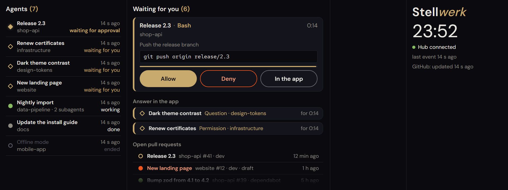

# Stellwerk

A signal box for your AI agents: a desk display for a wide second screen (made for 1920×720, ready
for touch) that shows every running Claude Code and Codex session and lets you answer their permission
requests right there. Like a dispatcher who sees every train on the track diagram and sets the signals.



## What it does

- **Every session at a glance.** In the left column, each session with its name (bold) and project, and
  its status: waiting for approval, waiting for you, working, done, ended. With whose agent it is
  ("Claude", "Codex", all alike), the number of running subagents and the time of the last activity. The
  most urgent first. Sessions done or unknown without an event for 30 minutes wait behind one line at the
  foot ("8 more at rest"), which a tap opens. After a restart of the hub the sessions of the last 12 hours
  are there again, grey and "unknown", until each sends its next event; their open requests are not, as
  those went back to the app when the hub stopped.
- **How full the context is.** In front of each session the percentage of its context window that is
  used, 0 to 100 %, over a thin line; from 80 % it needs attention, from 90 % it is red (the app
  compacts the context at about 97 %). The hub takes the token counts of
  the last answer from the session's transcript.
- **Permission requests on the display.** Each request becomes a card with the complete input: a shell
  command in full, a file change with path and content, an MCP call with server, tool and parameters.
  **Allow**, **Deny**, or **In the app** to leave it to the Claude app. The oldest request is on top and
  the only one with a filled **Allow**; each card shows how long it has been waiting and how much of the
  hold time is left.
- **The app works as before.** The Claude desktop app shows its own card at the same time, and whichever
  decides first counts. If nobody decides on the display within the hold time (60 s), the request goes
  back to the app. If the hub is not running, Claude Code simply asks in the app, without error messages.
- **What waits in the app.** When Claude asks you something (multiple choice, or in the desktop app's box
  at the end of a turn), needs some input, or has a permission open in the app, the session is listed
  below the cards under "Answer in the app", with the question and how long it has been waiting. You
  answer in the app; allow or deny would not answer a question.
- **Codex, if you like.** The Codex app's sessions and approvals appear among the others, marked
  "Codex" (see [Codex](#codex)).
- **Plan usage.** How much of your Claude and Codex plans' limits is used, from local sources only (see
  [Plan usage](#plan-usage)).
- **Open pull requests, if you like.** With a read-only GitHub token, the open pull requests of one
  owner (all repositories) are listed too, each with the state of its Actions runs.
- **Hardware, if you like.** Load and temperature of processor and graphics card and the memory in use,
  from LibreHardwareMonitor, which Stellwerk sets up for you.
- **Monitors, if you like.** The monitors of your Uptime Kuma in their own column: what is down stands
  out, what works is only a number (see [Uptime Kuma](#uptime-kuma)).
- **At rest when nothing is new.** After 10 minutes with nothing new and no open request the display
  dims, the clock still readable; anything new or a tap wakes it (`quietAfterMinutes`, see
  [Configuration](#configuration)).
- **Local only.** The hub listens on `127.0.0.1` and nowhere else and needs a token for every hook
  request. The display loads nothing from the internet. The hub opens connections to other machines only
  to `api.github.com` and to your Uptime Kuma, each only once you set it up.
- English and German, following the system language (`?lang=en` or `?lang=de` in the address picks
  one). One factor scales every size.

## Requirements

- Windows 10 or 11
- Node.js 24 (LTS)
- Claude Code: the Claude desktop app or the command line
- Microsoft Edge for the display (any Chromium browser works)

## Installation

From a [release](https://github.com/Azentrius/stellwerk/releases): download `stellwerk-VERSION.zip` and
`SHA256SUMS`, then in PowerShell (replace the version):

```powershell
(Get-FileHash stellwerk-0.5.4.zip).Hash    # must match the line in SHA256SUMS
gh attestation verify stellwerk-0.5.4.zip --repo Azentrius/stellwerk    # optional, needs gh
Expand-Archive stellwerk-0.5.4.zip -DestinationPath .
cd stellwerk-0.5.4
npm ci --omit=dev
npm link        # optional: makes the command `stellwerk` available everywhere
```

Or from the source:

```powershell
git clone https://github.com/Azentrius/stellwerk.git
cd stellwerk
npm ci
npm run build
npm link        # optional
```

Without `npm link`, use `node dist/cli.js` wherever this README says `stellwerk`.

1. Start the hub: `stellwerk serve`. On its first start it creates the token for the hooks.
2. Connect Claude Code: `stellwerk hooks install`. It shows what it adds to
   `%USERPROFILE%\.claude\settings.json`, asks before writing, keeps a backup of the previous file and
   sets the user environment variable `STELLWERK_TOKEN`.
3. Restart the Claude desktop app (and terminals that run Claude Code), so they pick up the token.
4. Once, in a terminal opened as administrator: `stellwerk install`. It adds a Windows Firewall rule
   that blocks the port for other machines, a second layer next to the fixed address.
5. Open the display with its start file and move the window to the second screen (F11 for full screen):

   ```powershell
   msedge "--app=$(([uri]"$env:LOCALAPPDATA\stellwerk\display.html").AbsoluteUri)"
   ```

   The hub writes `%LOCALAPPDATA%\stellwerk\display.html` when it starts (its console names it); only your
   Windows account can read it. It signs the display in at the hub, which answers with the display and the
   token it connects with. Opened at `http://127.0.0.1:4780` alone, the display says it is not signed in.

## Updating

Download the new release's `stellwerk-VERSION.zip` and `SHA256SUMS` into one folder, then:

```powershell
stellwerk update stellwerk-0.5.4.zip
```

It checks the zip against `SHA256SUMS`, unpacks it into a folder of its own
(`%LOCALAPPDATA%\stellwerk\releases\stellwerk-VERSION`), runs `npm ci --omit=dev` there and points the
two logon tasks at it; then restart them. The display stays on the screen its task uses now; give
`--screen <number>` (as `autostart install` lists them) to move it, or when that screen is gone: then
the update stops before it changes anything. Stellwerk downloads nothing itself. Settings, token and keys stay
where they are. Codex' hooks keep running the forwarder of the version that set them up, until you run
`stellwerk codex install` from the new folder.

## Start with Windows

```powershell
stellwerk autostart install
```

It lists your screens, shows the two tasks it adds to the Task Scheduler for your user and asks before
adding them. Both start at logon, without administrator rights:

- **Stellwerk hub** starts the hub without a window. Its messages go to
  `%LOCALAPPDATA%\stellwerk\hub.log` (moved to `hub.log.1` when it grows beyond 1 MB).
- **Stellwerk display** opens the display 20 s later with its start file in Edge's kiosk mode: full screen
  on the 1920×720 screen, without title bar and over the taskbar, with an Edge profile of its own. `--screen <number>`
  picks another screen. Alt+F4 closes the display.

The tasks start what is built in this folder. Run the command again after moving the folder, installing
Node.js elsewhere or rearranging the screens. After an update, restarting the hub is enough: the open
display notices that the hub serves a newer version and loads itself again.

Stop or start a task in the Task Scheduler or with `schtasks /End /TN "Stellwerk hub"` and
`schtasks /Run /TN "Stellwerk hub"`; the hub ends together with its task. `stellwerk autostart uninstall`
removes both tasks.

**Updating from 0.4.1 or older:** run `stellwerk autostart install` again, so that the display task
opens the start file, then restart both tasks; until then the display shows that it is not signed in.

## Open pull requests

Optional. On github.com create a fine-grained personal access token (Settings › Developer settings ›
Fine-grained tokens):

- Resource owner: the user or organisation whose pull requests you want to see
- Repository access: All repositories
- Permissions: **Pull requests: Read** and **Actions: Read**, nothing else

Then:

```powershell
stellwerk github token --owner Azentrius
```

It asks for the token without showing it, tries it once against `api.github.com` and keeps it, readable
by your Windows user only, in `%LOCALAPPDATA%\stellwerk\github-token`; the owner goes into
`config.json`. Only fine-grained tokens (`github_pat_…`) are accepted. Restart the hub afterwards.

Every two minutes the hub then asks `api.github.com` for the owner's repositories (archived ones are
left out), their open pull requests, and the Actions runs on each pull request's head commit. For a
personal account it adds the private repositories of that owner the token may see, which GitHub's list
of a user's repositories leaves out. Lists longer than one page are read to the end, following GitHub's
links only on `api.github.com`; more than 1000 entries in one list are reported as a problem instead of
showing an incomplete list. Each pull
request is one line; the icon in front of its title stands for its checks (its word is the tooltip and
the name a screen reader reads), so repository, number and author have room:

| Icon | Checks |
|---|---|
| green check mark: passed | all runs passed |
| red exclamation mark: failed | a run failed, timed out or was cancelled |
| grey hourglass: running | runs still going, or waiting for approval |
| none | no runs |

At the foot of the "Waiting for you" column, below the pull requests, the display says when the list was
last brought up to date, or why that failed (token rejected, no access, not reachable) and how to fix it. The token is never logged and never sent to the display.
`stellwerk github remove` deletes it; the hub then opens no connection to GitHub.

## Hardware values

Optional. Stellwerk reads the sensors through [LibreHardwareMonitor](https://github.com/LibreHardwareMonitor/LibreHardwareMonitor)
(MPL-2.0) and sets it up itself, in a terminal opened as administrator with your own account:

```powershell
stellwerk hardware install
```

It shows what it does and asks first:

1. Downloads exactly `LibreHardwareMonitor.zip` of version 0.9.6 from LibreHardwareMonitor's release on
   GitHub and checks its size and SHA-256 against the values in the code. Any other file is refused.
2. Unpacks it to `C:\Program Files\Stellwerk\LibreHardwareMonitor`. Only administrators can change files
   there, which matters because the program runs with administrator rights.
3. Turns on its web server on port 8085 with the user `stellwerk` and a new random password, and starts
   it minimized to the tray (closing its window keeps it running).
4. Adds the firewall rule `Stellwerk-block-inbound-8085`: version 0.9.6 listens on every network
   interface and cannot be limited to `127.0.0.1`.
5. Registers the task **Stellwerk hardware**, which starts it at logon with your administrator rights
   (reading the sensors needs them), and starts it.

Restart the hub afterwards. Every 5 s it asks `http://127.0.0.1:8085/data.json`, with the password it
reads from LibreHardwareMonitor's settings, and shows at the foot of the status column:

| Row | Values |
|---|---|
| CPU | total load, package temperature (AMD: Tctl/Tdie) |
| GPU | load and temperature of the graphics card; a separate card before the one built in |
| RAM | memory in use, in percent and GB |

From 90 °C on a temperature is marked with the warning triangle. If the values cannot be read, the status
column says why and how to fix it. Processor temperatures need the [PawnIO](https://pawnio.eu/) driver,
which you install yourself; without it the row shows the load only.

The password matters: LibreHardwareMonitor's web server can also set fan speeds and answers any web
page in a browser on this machine. With the password, a page can neither read the values nor change
anything. Do not open `http://127.0.0.1:8085` in a browser and let it remember the password.

A newer LibreHardwareMonitor comes with a newer Stellwerk, which pins its version and hash. Run
`stellwerk hardware install` again after updating. `stellwerk hardware uninstall` stops it and removes
the task, the firewall rule and the folder.

## Uptime Kuma

Optional. The third column shows the monitors of your [Uptime Kuma](https://github.com/louislam/uptime-kuma)
(version 2): what fails stands out, what works is only a number.

In Uptime Kuma create an API key (Settings › API Keys › Add API Key, a name such as "Stellwerk"). Then,
with Uptime Kuma's address:

```powershell
stellwerk kuma key --url http://192.168.0.130:3001
```

It asks for the key without showing it, tries it once against the address's `/metrics` and keeps it,
readable by your Windows user only, in `%LOCALAPPDATA%\stellwerk\uptime-kuma-key`; the address goes into
`config.json`. Restart the hub afterwards.

Every minute the hub then asks Uptime Kuma for `/metrics`, with the key as the password, and keeps of each
monitor only its name and status:

- **Down:** on top, the name in large letters with a red label, and how long the hub has seen it down.
- **Retrying:** a monitor Uptime Kuma tries again before it says down ("pending"), quieter below.
- **Everything else** is a number: "35 up", "1 in maintenance". Paused monitors are not counted, since
  Uptime Kuma leaves them out of its metrics, and neither are groups, which only sum up others.

When more fail than fit, the list scrolls by finger, mouse wheel or keyboard; the numbers and the line at
the foot stay in place.

How long a monitor fails is what the hub saw itself: a monitor that was already failing when the hub
first asked, or that changed while Uptime Kuma did not answer, shows no time until it changes again. The
hub remembers these times in `uptime-kuma.json` (only the ids of failing monitors and since when), so they
survive a restart of the hub if its last answer is no more than 15 minutes old. After a longer break they
are not taken: a monitor may have come back and failed again unseen. At the
foot of the column the display says when Uptime Kuma was last asked, or why that failed (not reachable,
key rejected, unexpected answer) and how to fix it.

An API key of Uptime Kuma 2 opens `/metrics` and nothing else: it can neither log in nor change a
monitor. On a plain `http://` address the key and the metrics go over your network unencrypted, so use it
only within your own network, or give an `https://` address. The key is never logged and never sent to
the display. `stellwerk kuma remove` deletes it; the hub then opens no connection to Uptime Kuma.

## Codex

Optional. Stellwerk shows the sessions of the Codex app and of Codex' command line too, marked "Codex"
and "Codex CLI", and lets you answer their approvals on the display:

```powershell
stellwerk codex install
```

It shows what it adds to `%USERPROFILE%\.codex\hooks.json` and asks first: for each Codex event a
command hook that runs Stellwerk's forwarder (`node …\dist\codex\hook.js`). Then restart the Codex app
and allow the new hooks: the hook symbol in its input field opens "Review hooks". Codex runs hooks only
after that, and again after any change to them.

How Codex differs:

- Codex' hooks are commands. The forwarder passes each event to the hub on `127.0.0.1` with the hook
  token from the token file and prints the hub's answer. Without a hub it ends at once, and Codex asks
  as usual.
- The Codex app shows its own approval card only after the hook has answered. So a Codex request waits
  on the display for 30 s (`codexHoldSeconds`, 10 to 35) and then goes to the app; **In the app** hands
  it over at once.
- With "Approve for me" Codex' own reviewer decides. Stellwerk then holds nothing and shows no card; it
  reads that setting from the session's transcript.
- Questions Codex asks you are listed under "Answer in the app". The app's short helper sessions, which
  have no transcript, are not shown.
- Codex' hook events carry no name for the session. The hub takes the name the Codex app shows for the
  chat from Codex' session index, so it stands in bold above the project, as for every other session.
  A new chat gets its name a few seconds after the first prompt, a renamed one its new name.
- The project below is the one the Codex app files the chat under, from the app's state file, not the
  folder; a chat without a project shows no second line.
- The context meter uses the window Codex records with its token counts.
- With its token counts Codex also records how much of your plan's limits is used (see
  [Plan usage](#plan-usage)).

Codex' command line (`codex` in a terminal) reads the same `%USERPROFILE%\.codex` as the app: the same
hooks, allowed once for both. Its sessions show as "Codex CLI", named by Codex' session index, with the
folder as the project; the hub tells them from the app's by the first line of their transcript. Its own
question for an approval shows in the terminal, and like the app only after the hook has answered, so
the third button of their cards says **In the terminal**. With Codex' default approval settings a
command the sandbox blocks (a download, say) simply fails without asking; started with
`codex -a on-request`, Codex asks, and the request comes to the display.

`stellwerk codex uninstall` removes exactly these hooks.

## Plan usage

Below the hardware the status column shows how much of your plans' limits is used: per provider a title
with how old the values are, then one row per window (5 h, Week) with the percent used and when the
window starts again. From 80 % a row needs attention, from 90 % it is red. Stellwerk opens no connection
for this and reads no login; the values come from two local sources:

- **Claude.** The desktop app gives its sessions a tool, `get_usage`, that reports the account's limits.
  When a session calls it, the `PostToolUse` hook carries the answer to the hub, which keeps only the
  limits. Sessions do not call it on their own; a line in your own instructions for Claude Code (the
  memory file in your profile) makes them, for example:
  "At the start of each task, call the desktop app's tool `get_usage` (`mcp__ccd_session_mgmt__get_usage`)
  once." Any session's call updates the values, as the limits are the account's. A model's own weekly
  limit (such as "Fable") shows only once it needs attention. Claude Code in a terminal has no such tool.
- **Codex.** Codex records its limits with its token counts in the transcript the hub reads anyway for
  the context meter.

The hub keeps the latest values in `plans.json`, so they are there again after a restart.

## How a permission request goes

1. Claude Code wants to run a tool that needs your permission and sends the request to the hub.
2. The hub holds it and shows a card. The Claude app shows its own card at the same time.
3. Whatever comes first decides:

| Outcome | What happened |
|---|---|
| Allowed | You tapped **Allow**; the tool runs. |
| Denied | You tapped **Deny**; Claude is told "Denied via Stellwerk". |
| Handed to the app | You tapped **In the app**; the app's card stays open. |
| Time is up | Nobody decided within the hold time; the app's card stays open. |
| Decided in the app | You answered in the app: allowed, rejected or cancelled with Esc. The card goes at once. |
| Cancelled | The session ended while the request was open. |

Every request and its outcome goes into the audit log. For a request decided in the app, the hub only
knows that it was answered there, not how; the tool's run (or its absence) shows in the session.

Once a file edit was allowed in the app, Claude Code may switch the session to accepting edits. Later
edits then need no permission at all, so no card appears for them.

## The hooks

`stellwerk hooks install` adds these HTTP hooks, all to `http://127.0.0.1:4780/hooks/claude-code` with the
header `Authorization: Bearer $STELLWERK_TOKEN`:

| Event | Used for | Timeout |
|---|---|---|
| `UserPromptSubmit` | working | 3 s |
| `PermissionRequest` | the card; the hub holds the request | 90 s |
| `Notification` | waiting for you (`idle_prompt`, `agent_needs_input`, `elicitation_dialog`, `permission_prompt`); other types are named once in `hub.log` | 3 s |
| `Elicitation` | an MCP server asks something during its tool call: answered at once and empty, so the app shows its own dialog; named once per server in `hub.log` | 3 s |
| `PostToolUse`, `PostToolUseFailure` | working; a card allowed in the app goes at once | 3 s |
| `Stop` | done | 3 s |
| `SubagentStart`, `SubagentStop` | counting subagents (pairs by `agent_id`) | 3 s |
| `SessionEnd` | ended, hidden after 10 minutes | 1 s |

The short timeouts keep a hung hub from slowing Claude Code down. None of the hooks blocks Claude Code
when the hub is not running. There is no `SessionStart` hook, because that event takes no HTTP hooks: a
session appears with its first event, which in the desktop app is the first prompt.
`stellwerk hooks uninstall` removes exactly these entries and the environment variable.

## Configuration

`%APPDATA%\stellwerk\config.json`, all optional:

```json
{ "port": 4780, "holdSeconds": 60, "sound": false, "quietAfterMinutes": 10, "scale": 1, "debugRawLog": false }
```

| Setting | Meaning |
|---|---|
| `port` | Port on 127.0.0.1. After a change run `stellwerk hooks install` again. The address cannot be changed. |
| `holdSeconds` | How long a request waits on the display before it goes back to the app: 10 to 80 (at least 10 s below the hook timeout of 90 s). |
| `sound` | A soft chime for each new request. |
| `quietAfterMinutes` | The display rests, dimmed with the clock still readable, after this many minutes with nothing new and no open request: 0 (never) to 1440, 10 by default. A new request, a new answer due in the app, a monitor going down, a new pull request or failed checks wake it, and so does a tap, which presses nothing else. |
| `scale` | Scales every size of the display (0.5 to 3). At 1, no text is smaller than 20 px and no button lower than 64 px. |
| `debugRawLog` | Writes every hook request as received to `debug-raw.jsonl`, like `stellwerk serve --debug-raw`. It holds prompts and code; `stellwerk raw-log delete` deletes it. |
| `githubOwner` | Whose open pull requests to list; set by `stellwerk github token --owner`. Needs the GitHub token. |
| `githubIntervalSeconds` | How often to ask GitHub: 60 to 3600, 120 by default. |
| `hardwareMonitor` | Show the hardware values; set by `stellwerk hardware install` and `uninstall`. |
| `uptimeKumaUrl` | Uptime Kuma's address, such as `http://192.168.0.130:3001` (no path); set by `stellwerk kuma key --url`. Needs the API key. |
| `uptimeKumaIntervalSeconds` | How often to ask Uptime Kuma: 30 to 3600, 60 by default. |
| `contextWindows` | Context windows by model id for the context meters, for models Stellwerk does not know, e.g. `{ "claude-sonnet-5-5": 1000000 }`. Known: Opus 5.5 with 1M. Otherwise 200k, or 1M once more than 200k are in use. Codex records its window itself. |
| `codexHoldSeconds` | How long a Codex request waits on the display before the Codex app shows its own card: 10 to 35, 30 by default. |

Restart the hub after a change.

## Files

| Path | What |
|---|---|
| `%APPDATA%\stellwerk\config.json` | Configuration |
| `%LOCALAPPDATA%\stellwerk\token` | The hook token; only your Windows user can read it |
| `%LOCALAPPDATA%\stellwerk\display.html` | The display's start file with the key that signs it in, written by the hub; only your Windows user can read it |
| `%LOCALAPPDATA%\stellwerk\audit.jsonl` | Audit log: every permission request with time, session, project, tool, input and outcome |
| `%LOCALAPPDATA%\stellwerk\debug-raw.jsonl` | Raw hook data, only in debug mode |
| `%LOCALAPPDATA%\stellwerk\hub.log` | Messages of the hub started at logon |
| `%LOCALAPPDATA%\stellwerk\edge-display\` | Edge profile of the display started at logon |
| `%LOCALAPPDATA%\stellwerk\github-token` | The read-only GitHub token, if set up; only your Windows user can read it |
| `%LOCALAPPDATA%\stellwerk\uptime-kuma-key` | The API key of Uptime Kuma, if set up; only your Windows user can read it |
| `%LOCALAPPDATA%\stellwerk\plans.json` | The latest usage of your plans' limits, for the display after a restart |
| `%LOCALAPPDATA%\stellwerk\sessions.json` | The sessions on the display (id, folder, title, project, context, last activity), for the display after a restart |
| `%LOCALAPPDATA%\stellwerk\uptime-kuma.json` | Since when monitors of Uptime Kuma fail (ids and times only), for the display after a restart |
| Tasks `Stellwerk hub`, `Stellwerk display` | Start with Windows, in the Task Scheduler |
| `%USERPROFILE%\.claude\settings.json` | Claude Code's settings with the hooks; backups next to it as `settings.json.stellwerk-….bak` |
| User environment variable `STELLWERK_TOKEN` | The token for Claude Code |
| Firewall rule `Stellwerk-block-inbound-4780` | Blocks the port for other machines |
| `C:\Program Files\Stellwerk\LibreHardwareMonitor\` | LibreHardwareMonitor with its settings, if set up |
| Task `Stellwerk hardware`, firewall rule `Stellwerk-block-inbound-8085` | Its start at logon, and its port closed to other machines |
| `%USERPROFILE%\.codex\hooks.json` | Codex' hooks with Stellwerk's forwarder, if set up; backups next to it as `hooks.json.stellwerk-….bak` |

## Safety

- The hub listens on `127.0.0.1` only; the address is fixed in the code. The firewall rule is a second
  layer.
- Hook requests need the token and `Content-Type: application/json` (otherwise 401 and 415). The content
  type makes a browser ask first (CORS preflight), which the hub never answers, so no web page can post
  events.
- The display signs in before it gets anything: its start file, which only your Windows account can
  read, posts a key derived from the hook token to the hub, and only that answer carries the page token
  the WebSocket needs. The display keeps it in its tab's storage for the hub's address and port, which
  no other site or port can read, and sends it only in the WebSocket handshake. There is no cookie:
  browsers send cookies of `127.0.0.1` to every port, so another local service, also one of another
  account, would get it. The address alone gives no token; the key is in no address and no log. A test
  in a real Edge (`tools/check-browser.ts`, also in CI) visits a second local service after the sign-in
  and checks that it gets nothing to decide with.
- Decisions travel only over the display's WebSocket. The hub checks `Host` and `Origin` (against
  DNS rebinding and foreign pages) and the page token. A broken
  or oversized message closes only its own connection.
- Nothing is allowed automatically: no rules, no "always allow". A question of an MCP server
  (`Elicitation`) the hub never answers; the app asks you itself.
- The hub starts no programs. It connects to other machines only to `api.github.com`, for the list of
  pull requests, and only with a fine-grained read-only token you set up; and to Uptime Kuma at the
  address you set up, only for `/metrics` and only with its API key. Besides that it asks
  LibreHardwareMonitor on `127.0.0.1:8085` for the sensor values, if you set it up, and nothing else of
  it. The display loads only the hub's own files under a strict Content Security Policy and shows hook
  data and pull request titles as text, never as HTML.
- For the context meters the hub reads session transcripts, only under `%USERPROFILE%\.claude\projects`
  and `%USERPROFILE%\.codex\sessions` (a path elsewhere in a hook event is ignored), only from their end,
  and only the token counts, the model, the context window, the session's title and, for Codex, who
  approves and the usage of the plan's limits. Prompts, code and answers in them are not read into the hub's state and never reach
  the display.
- Of what tools return, the hub looks only at the desktop app's answer to `get_usage`, and keeps only
  the plan's limits from it (percent, window, reset, the model of a model's own limit).
- For the names of Codex sessions the hub reads Codex' session index
  (`%USERPROFILE%\.codex\session_index.jsonl`) from its end, and only the name of a session it shows.
  For their projects it reads the Codex app's state file (`%USERPROFILE%\.codex\.codex-global-state.json`)
  when it changed, and keeps only the names of projects and which chat belongs to which; the rest of the
  file (the app's drafts and window state) is not kept.
- Codex events come through Stellwerk's forwarder to their own endpoint, with the same checks as the
  others (token, content type, `Host`). The forwarder reads the hook token from the token file, talks
  only to `127.0.0.1` and prints only the hub's answer.
- `stellwerk hardware install` downloads one file, pinned by size and SHA-256, and unpacks it only into
  its own folder in Program Files. LibreHardwareMonitor runs with administrator rights; its web server
  needs a password and is closed to other machines by a firewall rule.
- Hook requests are limited to 1 MB, open requests to 20 at a time.

Details and how to report a problem: [SECURITY.md](SECURITY.md).

## When nothing shows up

When the hub turned requests away, the status column says so as a warning: how many, when and why the
last one (a missing or wrong token, hook data it could not take, a request from elsewhere, a display
without sign-in). The hub's console (or `hub.log`, when it started with Windows) has the details, at most
once a minute per reason and never with the token:

| Message | What to do |
|---|---|
| `hook request without a token (401)` | Claude Code has no `STELLWERK_TOKEN`: run `stellwerk hooks install`, then restart the Claude app. |
| `hook request with a wrong token (401)` | The token file was renewed: run `stellwerk hooks install` again, then restart the Claude app. |
| `request with the Host header … (403)` | Open the display at `http://127.0.0.1:4780` or `http://localhost:4780`, not under another name. |
| `display sign-in with a wrong key` | The token changed since the start file was opened: start the hub, then the display again. |
| `display connection without the right page token` | Open the display with its start file (`%LOCALAPPDATA%\stellwerk\display.html`), or start the task "Stellwerk display" again. |

If the console stays silent, Claude Code sends nothing: check that the hooks are in
`%USERPROFILE%\.claude\settings.json` and that the session was started after `stellwerk hooks install`.

If a Codex chat stays away while others show: Codex starts its hooks in the chat's folder, and a chat
keeps its folder when that is renamed or moved. With the folder gone, Codex starts no hook for the chat
and reports no error. Start a new chat in the project, or put a junction with the old name where the
folder was (`New-Item -ItemType Junction -Path <old> -Target <new>`; remove it with `cmd /c rmdir <old>`,
not with `Remove-Item`, which in Windows PowerShell 5.1 can delete what the junction points to).

While the raw hook log is on (`debugRawLog` or `--debug-raw`), the status column says so: the file holds
prompts and code, so turn it off and delete `debug-raw.jsonl` when you are done.

## Uninstall

```powershell
stellwerk autostart uninstall
stellwerk github remove
stellwerk kuma remove
stellwerk hooks uninstall
stellwerk codex uninstall
stellwerk hardware uninstall # as administrator: LibreHardwareMonitor, its task and firewall rule
stellwerk uninstall          # as administrator: removes the firewall rule
npm rm -g stellwerk          # if you used npm link
Remove-Item -Recurse "$env:LOCALAPPDATA\stellwerk", "$env:APPDATA\stellwerk"
```

Restart the Claude desktop app afterwards.

## Development

```powershell
npm run typecheck
npm test                 # unit tests and the hub end to end; runs the TypeScript sources directly
npm run build            # dist/: the hub and the display
npm run demo             # a hub on port 4781 with made-up sessions and requests, own token and audit log
npm run package          # build/: stellwerk-VERSION.zip and SHA256SUMS, reproducible
node dist/cli.js serve --debug-raw --simulate-hang
```

`--simulate-hang` leaves status hooks unanswered, to see how Claude Code behaves with a hung hub. The hub
reads the display's files when it starts: after `npm run build`, restart it. The screenshot above is the
demo at `http://127.0.0.1:4781/?lang=en`, taken with Edge at 1920×720.

What comes next is in [ROADMAP.md](ROADMAP.md).

## Releasing

1. Set the version in `package.json` (with `npm version --no-git-tag-version X.Y.Z`, which updates the
   lockfile too) and give its section in `CHANGELOG.md` the date: `## X.Y.Z – YYYY-MM-DD`.
2. Merge to `main`.
3. On GitHub: Actions › **release** › Run workflow (branch `main`). The workflow runs all tests on
   Windows, checks that the version is new and matches `package.json` and that its changelog section has
   a date, builds `stellwerk-X.Y.Z.zip` with `SHA256SUMS` (reproducible, from the time of the commit),
   signs a build provenance for it and creates the tag `vX.Y.Z` with a release whose notes come from
   `CHANGELOG.md`. Releases cannot be changed afterwards.

## License

Stellwerk is licensed under the [Apache License 2.0](LICENSE); see also [NOTICE](NOTICE). The fonts DM
Sans, DM Serif Display and Red Hat Mono are licensed under the SIL Open Font License 1.1. The icons are
Font Awesome Free 5.15.4 by Fonticons, Inc., taken over through `@patternfly/react-icons` 6.4.0 and
licensed under CC BY 4.0 ([ui/CC-BY-4.0-Font-Awesome.txt](ui/CC-BY-4.0-Font-Awesome.txt)). The Stellwerk
sign (`ui/icon.svg`) is a mark of Azentrius and is not licensed under the Apache License.

Made by [Azentrius](https://azentrius.com).
